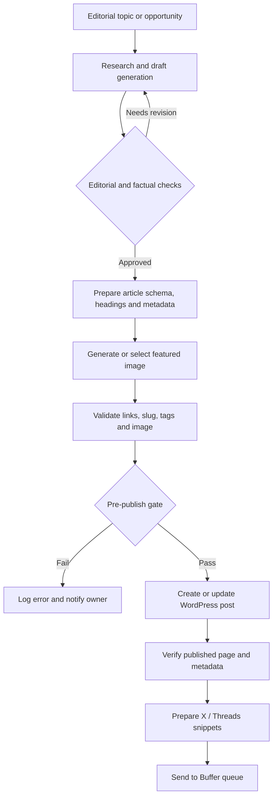

# AI Content Publishing Automation — Workflow Case Study

**Status:** Documentation of a working-style workflow described for [Boost With AI](https://boostwithai.se/). This repository does **not** include an exported or independently tested Make scenario.

## Problem

A small editorial operation must turn keyword insights into reviewed, formatted, search-friendly WordPress content while consistently producing images and social updates. Manual handoffs are slow and fragile.

## Workflow outline

This is a **conceptual reconstruction** of the workflow; nodes and gates are not an exported proof of exact live Make configuration. The current content pipeline has been discussed as automated publishing. Manual review in the chart is a recommended control, not a verified existing gate.

## Tools & integration roles

- **Make** — orchestration and branching
- **AI model(s)** — research assistance and drafting
- **WordPress / Yoast** — post creation and SEO fields
- **Image generation** — featured images
- **Buffer** — social queue and distribution
- **Google Search Console** — optional opportunity signal from a separate monthly workflow

## Measurable success criteria

| Metric | Definition |
|---|---|
| Publish success rate | Verified published posts ÷ attempts |
| Failed article rate | Attempts rejected by validation ÷ attempts |
| Human review effort | Minutes spent verifying sources and quality per post |
| Link integrity | Valid links ÷ all outbound/internal links checked |
| Time to publish | Draft creation → verified live publication |
| Distribution completion | Confirmed scheduled social posts ÷ intended posts |

## Reliability and safety checklist

1. Keep API tokens in connection vaults; never commit credentials or live webhook URLs.
2. Enforce idempotency using source item ID / stable slug to prevent duplicate publishing.
3. Remove placeholder tokens, e.g. `[LINK:]`, before publishing.
4. Validate citations, external links, affiliate disclosures, and factual claims before publishing.
5. Distinguish generated images from editorial screenshots and manage usage rights.
6. Track failures, retries and manual review states in an operational log.
7. Check WordPress post status and URL after API calls; HTTP 200 alone is not publication success.
8. Treat claims of 'fully automatic' as operational configuration, not a quality guarantee.

## What is deliberately not in this repository

No Make blueprint, live account identifiers, WordPress tokens, Buffer credentials, internal prompts, production dashboards, or client records. Export and sanitize the real scenario if publishing it becomes appropriate.

## Next documented evidence to add

- A scrubbed screenshot or exported blueprint
- Successful and failed execution examples with dummy data
- A change log for the production pipeline
- A one-page breakdown of costs and failure recovery

**Author:** Adam Amrullah · Portfolio documentation · November 2026
